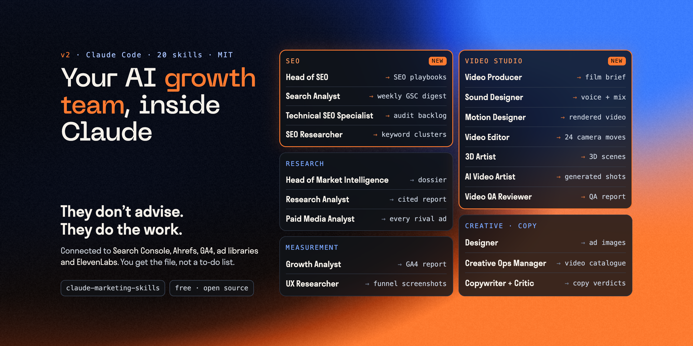

# Claude Marketing Skills: AI agents for marketing in Claude Code

[](https://github.com/tymoshenko-dmytro/claude-marketing-skills/releases)
[](LICENSE)
[](#installation)

Claude Code skills that turn Claude into an AI growth team. Ten agents research competitors, pull ads from the public libraries, read Ahrefs and GA4, screenshot funnels, make ad images and videos, and check every line of copy. Each one works on your real data, not on general advice. Use them to strengthen a growth team, or to run growth without one. Install them as a Claude Code plugin or with `npx skills`.

Works with [Claude Code](https://code.claude.com) and any agent that supports the [Agent Skills](https://agentskills.io) format.

Built by [Dmytro Tymoshenko](https://www.linkedin.com/in/tymoshenko-dmytro), Head of Growth at Palabra.ai and ex-CEO of Eightify.

https://github.com/user-attachments/assets/116f521c-f7db-45c3-a646-270dd013aecc

*The ten agents at work, from competitor research to ads to analytics, in 70 seconds. Sound on.*

**Contributions welcome.** Found a fix or have a new skill? [Open a PR](CONTRIBUTING.md). Question or problem? [Open an issue](https://github.com/tymoshenko-dmytro/claude-marketing-skills/issues).

## Why install these instead of writing your own?

You can write a skill in an evening. Making one that works on real data takes months of fixing what goes wrong. These skills already contain those fixes:

- **They do the work, not give advice.** Each skill connects to a real source (Ahrefs, GA4, Meta, LinkedIn and Google ad libraries, Parallel, a real browser, OpenAI images, ElevenLabs) and returns a file you can use: a dossier, a report, screenshots, images, a video.
- **They know the traps.** Each skill already handles the cases where an ad library, Ahrefs or GA4 gives misleading data.
- **Every fact has a source.** Research skills link each claim to the page it came from, so you can check the work before you act on it.
- **Setup takes minutes.** The `connect` skill walks you through each key, keeps the keys out of the chat, and tests each one with a free request.
- **They work as one team.** The research lead runs the researcher, the paid-media analyst and the SEO lead together. The critic reviews the copy of every other skill.
- **They are templates.** Every skill ends with an **Adapt it** section, so it learns your rules, your funnel and your brand.

## Meet the team: 10 AI marketing agents



| Agent | Skill | What it does | Works with |
|---|---|---|---|
| **Head of Market Intelligence** | [`competitor-research`](skills/competitor-research/) | Builds a full dossier on a competitor from its domain: product, pricing, customers, ads, SEO, team and press. It runs the other research agents and gives you a knowledge base and an HTML report | Parallel, SearchApi, Ahrefs |
| **Research Analyst** | [`parallel-research`](skills/parallel-research/) | Does deep research on any question: a quick sourced search in seconds, or a cited report in 5 to 60 minutes | Parallel |
| **Paid Media Analyst** | [`ads-parser`](skills/ads-parser/) | Gets every ad a company runs in the LinkedIn, Google and Meta libraries: text, images, videos, run dates, and impressions where the library shows them | SearchApi |
| **SEO Lead** | [`ahrefs-seo`](skills/ahrefs-seo/) | Gets keywords, volumes, difficulty, top pages, backlinks and Domain Rating for any site. A guide shows what each request costs | Ahrefs |
| **Growth Analyst** | [`ga4-reports`](skills/ga4-reports/) | Answers GA4 questions asked in plain words: traffic, channels, period comparisons and funnel drop-off | Google login |
| **UX Researcher** | [`funnel-screenshots`](skills/funnel-screenshots/) | Goes through a competitor's quiz or onboarding funnel and takes a retina iPhone screenshot of every screen, up to the paywall | Playwright (installs itself) |
| **Designer** | [`image-gen`](skills/image-gen/) | Makes ad images, blog covers and illustrations, and checks that the text in each picture came out as written | OpenAI |
| **Motion Designer** | [`motion-card`](skills/motion-card/) | Makes short video cards with a voiceover. They are built from code, so every word appears exactly as written and you can change it | HyperFrames, ElevenLabs |
| **Creative Ops Manager** | [`ads-video-library`](skills/ads-video-library/) | Names your ad videos, files them and lists them in a catalogue. It also makes a review page where each video gets approved or rejected | FFmpeg, Google Drive (optional) |
| **Senior Marketing Copywriter** | [`plain-copy`](skills/plain-copy/) + [`copy-critic`](agents/copy-critic.md) | Rewrites copy so a stranger understands it in one read. A critic agent gives every line a verdict and a rewrite | none |
| *Onboarding* | [`connect`](skills/connect/) | Sets up keys, Google login and MCP servers, then runs a health check | none |

## How the team works together

```
                         ┌───────────────────────────────┐
                         │            connect            │
                         │  keys · MCP servers · checks  │
                         └───────────────┬───────────────┘
                                         │
        ┌────────────────────────────────┼────────────────────────────────┐
        ▼                                ▼                                ▼
 ┌──────────────────────┐   ┌───────────────────────────┐   ┌───────────────────────────┐
 │ RESEARCH             │   │ MEASUREMENT               │   │ CREATIVE                  │
 │                      │   │                           │   │                           │
 │ competitor-research  │   │ ga4-reports               │   │ image-gen                 │
 │   ├ parallel-research│   │ funnel-screenshots        │   │ motion-card               │
 │   ├ ads-parser       │   │                           │   │   └ ads-video-library     │
 │   └ ahrefs-seo       │   │                           │   │                           │
 └──────────┬───────────┘   └─────────────┬─────────────┘   └─────────────┬─────────────┘
            │                             │                               │
            └──────────── findings, ads, screens, drafts ─────────────────┘
                                          ▼
                         ┌───────────────────────────────┐
                         │  plain-copy  ↔  copy-critic   │
                         │  every line gets a verdict    │
                         └───────────────────────────────┘
```

## Installation

### Option 1: Claude Code plugin (recommended)

```bash
/plugin marketplace add tymoshenko-dmytro/claude-marketing-skills
/plugin install marketing-agent-kit@marketing-agent-kit
```

### Option 2: skills CLI

```bash
npx skills add tymoshenko-dmytro/claude-marketing-skills                     # all skills
npx skills add tymoshenko-dmytro/claude-marketing-skills --skill ads-parser  # one skill
```

### Option 3: clone and copy

```bash
git clone https://github.com/tymoshenko-dmytro/claude-marketing-skills.git
cp -R claude-marketing-skills/skills/ads-parser ~/.claude/skills/
cp claude-marketing-skills/agents/copy-critic.md ~/.claude/agents/
```

## First run

Ask Claude: **"Set up the kit for competitor research"**. The `connect` skill creates a private keys file, helps you get each key, and checks every connection with a free request.

## How to use Claude Code for marketing

Ask in plain words. Claude picks the right agent:

```
"Research competitor example.com and build a knowledge base"   → competitor-research
"What ads is Example running on LinkedIn and Meta right now?"   → ads-parser
"Which pages bring example.com the most organic traffic?"       → ahrefs-seo
"Compare last month's sign-ups by channel with the month before" → ga4-reports
"Screenshot every step of the quiz at example.com/start"        → funnel-screenshots
"Make two ad images for this headline, draft quality"           → image-gen
"Make a 10-second end card: 'Spring sale: 20% off'"             → motion-card
"Would a stranger understand this headline?"                    → plain-copy + copy-critic
```

You can also run a skill directly: `/competitor-research`, `/ads-parser`, `/ga4-reports`.

## Claude Code skills by category

### Research and intelligence
- `competitor-research`: full competitor dossier (runs the next three)
- `parallel-research`: deep, sourced web research
- `ads-parser`: a Claude ads skill that pulls competitor ads from the public libraries
- `ahrefs-seo`: a Claude SEO skill with Ahrefs data for any domain

### Measurement and UX
- `ga4-reports`: GA4 reports from a plain question
- `funnel-screenshots`: every screen of a funnel, up to the paywall

### Creative
- `image-gen`: ad images, covers and illustrations
- `motion-card`: video cards with a voiceover
- `ads-video-library`: naming, catalogue and review page for ad videos

### Copy
- `plain-copy` and `copy-critic`: clear copy, a verdict and a rewrite for every line

## Read before you install

Install only the skills you will use this month. Every installed skill adds its description to every conversation. Then do the **Adapt it** part of each one: the skills work best once they hold your corrections, report rules, funnel events and brand.

## Keys and privacy

All keys live in one file outside any repository: `~/.config/marketing-agent-kit/.env` (chmod 600). Never paste keys into a chat. Research output and catalogues are in `.gitignore`. [More on connections →](connections/README.md)

## Requirements

- Python 3.9+ (scripts use the standard library only; Google Drive mode of `ads-video-library` needs `pip install google-auth requests`)
- FFmpeg for `ads-video-library` and `motion-card`; Node.js 18+ for Playwright MCP, 22+ for HyperFrames; `gcloud` + `pipx` for Google services; ~400 MB for `funnel-screenshots` (its setup installs Playwright and Chromium)

## Works well with

Good work by others. Read before installing, same rule as above.

| What | Why |
|---|---|
| Anthropic document skills (`docx`, `pdf`, `pptx`, `xlsx`) | decks, reports and spreadsheets as files, available in Claude apps |
| [HyperFrames](https://github.com/heygen-com/hyperframes) (Apache-2.0) | videos rendered from HTML/CSS; pairs with `ads-video-library` |
| [Higgsfield skills](https://github.com/higgsfield-ai/skills) (MIT) | generative video and image ads |
| [/brag](https://github.com/latent-spaces/brag) (MIT) | launch videos of what you built; inspired the poster / frame-0 step here |
| [Impeccable](https://github.com/pbakaus/impeccable) | design review commands (audit, polish, critique) for landing pages |
| [Humanizer](https://github.com/blader/humanizer) (MIT) | removing AI-writing patterns from long texts |

## Credits

- Poster selection and the frame-0 technique in `ads-video-library` are adapted from [/brag](https://github.com/latent-spaces/brag) by Shunit Haviv Hakimi (MIT).
- Connection facts checked against vendor documentation on 2026-10-01.

## Contributing

Found a way to improve a skill? Have a new one? See [CONTRIBUTING.md](CONTRIBUTING.md).

## License

[MIT](LICENSE) © 2026 Dmytro Tymoshenko · [LinkedIn](https://www.linkedin.com/in/tymoshenko-dmytro)
